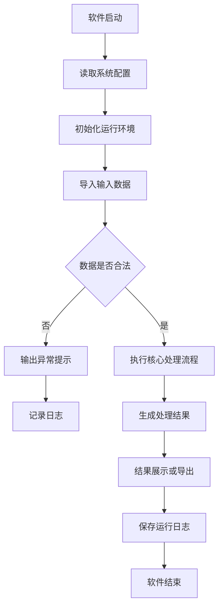
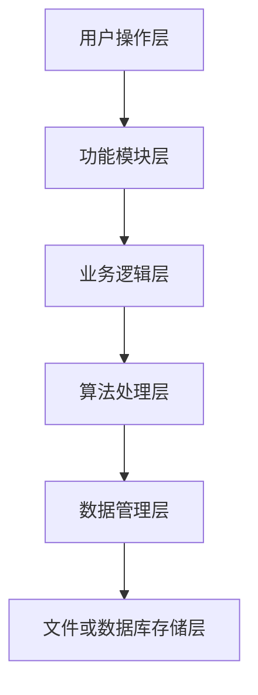

# Software Copyright Writer

Use this skill to produce Chinese software copyright application materials grounded in the user's actual software artifacts.

## Core Rule

Base all technical claims on available code, configuration, documentation, templates, and user-provided facts. Do not invent unavailable core functions, performance claims, certifications, legal conclusions, private deployment details, passwords, keys, or complete confidential source code.

Use cautious wording when evidence is incomplete:

- "根据现有源码结构可知..."
- "从文件命名和调用关系来看..."
- "该模块主要承担..."
- "该部分可根据实际部署情况进一步补充..."

## Inputs To Collect Or Infer

Collect paths and facts when available:

- Source code folder or archive.
- Reference soft-copyright documents.
- Word template or required formatting rules.
- Target document type: default to "软件设计说明书" unless the user requests "软件使用说明书", "用户操作手册", "系统设计说明书", "技术说明书", or another type.
- Software name, version, abbreviation, language, framework, development tools, runtime environment, database, dependencies, input data, output data, deployment mode, target users.
- Output folder, required page count, required diagrams, required tables, and PDF export requirement.

If the user gives only partial information, proceed with available materials and explicitly mark inferred or uncertain items.

## Workflow

1. Inventory files.
   - Classify source files, configuration files, dependency files, database files, UI files, scripts, model files, documents, and build/deployment files.
   - Identify entry points, startup commands, major directories, dependencies, and runtime environment.

2. Analyze software structure.
   - Extract modules, responsibilities, inputs, outputs, related files, classes, functions, APIs, data files, and exception handling.
   - For MATLAB/Simulink projects, identify parameter initialization, model loading, simulation execution, data acquisition, algorithm calculation, plotting, and export files.

3. Build the document plan.
   - Match the user's requested document type and template.
   - Use reference documents for chapter structure, table density, figure caption style, and wording style only.
   - Avoid copying long passages from references.

4. Generate diagrams and tables.
   - Prefer Mermaid for intermediate diagrams and render to images when inserting into Word.
   - Include diagrams that are meaningful for the software, typically: system architecture, function structure, main program flow, data processing flow, module call relationship, database structure, user operation flow, or deployment structure.
   - Include formal tables for runtime environment, development environment, functional modules, file structure, classes/functions, interfaces, input/output parameters, exception handling, test cases, and version information.

5. Write the document.
   - Use formal Chinese technical prose.
   - Use "本软件", "本系统", "该模块", "用户可..." instead of academic-paper phrasing.
   - Expand content with meaningful technical detail, not filler.
   - For 20+ page requests, strengthen module design, core workflow, function descriptions, operation steps, testing, maintenance, and appendices.

6. Format and verify.
   - If a Word template is provided, preserve page size, margins, cover, heading hierarchy, fonts, paragraph spacing, line spacing, table style, captions, page numbers, headers, and footers where practical.
   - If using the Documents plugin or local DOCX tools, render or inspect the output before delivery when feasible.
   - Export PDF only when requested or readily available.

## Default Chapter Structure

Use this structure unless the template or user request requires another one:

```text
封面
目录

第1章 软件概述
1.1 软件名称与版本
1.2 开发背景
1.3 开发目的
1.4 适用范围
1.5 主要特点
1.6 文档编写目的

第2章 软件运行环境
2.1 硬件环境
2.2 软件环境
2.3 开发环境
2.4 运行依赖
2.5 数据存储环境
2.6 环境配置说明

第3章 软件总体设计
3.1 设计目标
3.2 总体架构
3.3 功能结构
3.4 工作流程
3.5 数据处理流程
3.6 模块调用关系

第4章 功能模块设计
第5章 数据设计
第6章 接口设计
第7章 核心流程与算法说明
第8章 用户操作说明
第9章 测试与验证
第10章 维护与升级

附录A 主要源代码文件说明
附录B 核心类与函数说明
附录C 术语说明
```

For "软件使用说明书" or "用户操作手册", shift emphasis toward installation, startup, login, configuration, main workflows, input/output, query/export, exception prompts, FAQ, and maintenance.

## Required Tables

Create relevant tables with formal captions:

- 软件运行环境表
- 开发环境表
- 功能模块说明表
- 文件结构说明表
- 核心类/函数说明表
- 接口说明表
- 数据库表结构说明表, when applicable
- 输入输出参数表
- 异常处理说明表
- 测试用例表
- 软件版本说明表

## Diagram Guidance

Generate only diagrams supported by the software structure. Prefer clean black-and-white or academic-style visuals.

Common Mermaid starters:





## Writing Style

Prefer objective technical expressions:

- "本软件主要用于..."
- "系统通过...实现..."
- "该模块负责..."
- "用户可通过...完成..."
- "系统在运行过程中首先...随后...最后..."

Avoid:

- First-person phrasing such as "我认为" or "我们可以".
- Marketing language such as "非常强大" or "特别先进".
- Research-paper phrasing unless the user explicitly requests a research-style technical report.
- Unsupported performance, accuracy, compliance, or ownership claims.

## Compliance Checklist

Before delivery, verify:

- The document is based on the user's code and materials.
- Template and reference documents were used appropriately.
- Uncertain facts are marked cautiously.
- Sensitive data is removed or masked.
- Tables, figures, captions, headings, and terminology are consistent.
- The document contains required diagrams and tables when requested.
- The page-count target has been pursued with meaningful technical content.
- The final files are saved in the requested output folder.

